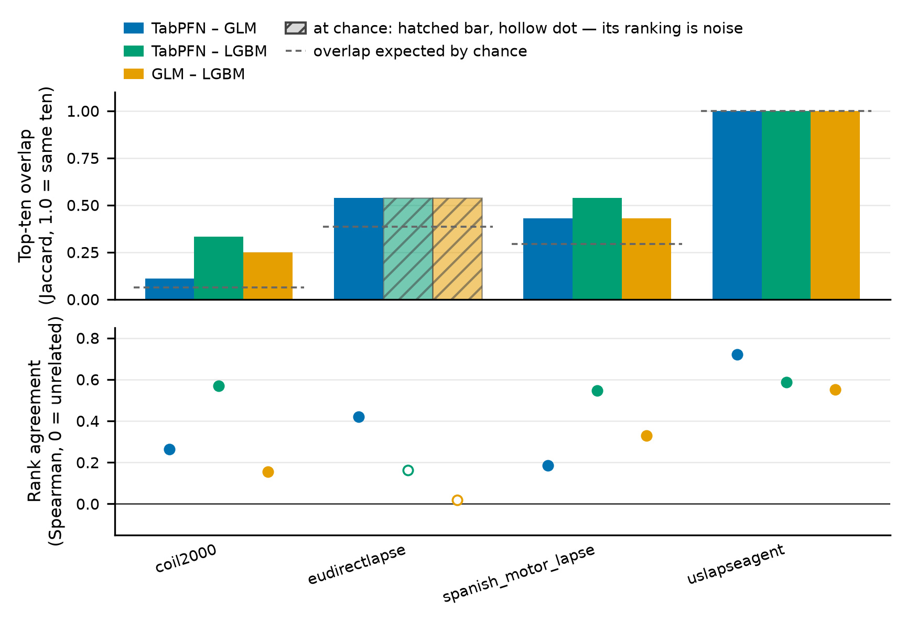

# Analysis data tables

The tables in this directory are generated from committed evidence. Each one can be regenerated
from the run it names, and each row says which bytes it rests on. Nothing here is hand-edited.

## `20261031T021845Z-predictions.csv`

One row per prediction from the fine-tuning anchor's run: 4 arms × 2 seeds × 1,000 test rows.

| Column | Meaning |
| --- | --- |
| `run_id` | the run this prediction came from (`results/20261031T021845Z/`) |
| `dataset` | `uslapseagent` |
| `arm` | the training configuration: `A_raw`, `B_ft3`, `B_ft10`, `B_ft30` |
| `seed` | 43 or 44 — each seed is its own split and its own fit |
| `row` | position in the test array, 0-based. **Not** the row in `data/raw/uslapseagent.csv` — a v3 capture carries that mapping in `test_index.npy` (#538); this v1 anchor does not |
| `y_true` | the true label, 0 or 1 |
| `probability` | the model's positive-class probability for that row |
| `capture_sha` | sha256 of the predictions array this row came from |
| `source` | which artifact verified the array: `capture.json` or the arm's `meta.json` |

Regenerate it with:

```
python scripts/analyses/export_predictions.py --run results/20261031T021845Z
```

The command verifies both array hashes against `results/20261031T021845Z/capture.json` before it
writes. If a hash does not agree it refuses and names both values, so a table here cannot rest on
altered bytes.

**Open it how you like.** It is plain CSV: pandas (`pd.read_csv`), R (`read.csv`), or a
spreadsheet. `y_true` and `probability` are all you need for any metric that scores probabilities
against labels. To check a row against the raw evidence, `capture_sha` matches the entry in
`results/<run_id>/capture.json`.

## What you can and cannot do with it

**You can** compute any scores-only metric yourself, with no code from this repo: a different ECE
binning, cost-weighted thresholds, precision–recall at a chosen operating point, bootstrap
intervals, per-row loss distributions.

**You cannot** attach these rows to customer attributes. This table is exported from a v1 capture,
which stores the two arrays and their hashes and nothing else, so `row` identifies a prediction
within an arm and seed but not a row of the source table. A v3 capture (#538) adds
`test_index.npy`, whose values are the `data/raw/<dataset>.csv` row numbers, so segment, fairness and
"error by age band" analyses become possible for runs recorded after that contract; this anchor
predates it and cannot be retrofitted.

## Explore or cite

- **Exploring?** Use the table. Nothing further is required.
- **Citing a number in a document?** The number needs a name and a version in
  `../../shared/METRIC_REGISTRY.md`, and a rescore CSV beside this one that carries
  `recorded_value` and `agrees`. The record wins where both can produce a number (#357).

The run id you cite must have a `capture.json`; a cited run without one fails the gate (#364).

## Rescore tables

`rescore` writes `<run_id>-rescore-<metricset>.csv` here, one row per arm × seed (× fold, for a
folded capture) × metric, with
the metric version, the capture hash, the tool version, the record's value and whether the two
agree. Regenerate with:

```
python scripts/analyses/rescore.py --run results/20261031T021845Z
```

## Diagnostic record tables

A diagnostic writes its record under `outputs/diagnostics/`, which is git-ignored: a record is
runtime evidence, produced by running the diagnostic. That leaves the campaign unreadable from a
clean checkout, so each record is also exported here as a table. One table per diagnostic, one row
per thing the diagnostic measured. Regenerate with:

```
python3 scripts/diagnostics/export_records.py --run tests/fixtures/diagnostics/d2_importance
python3 scripts/diagnostics/export_records.py --run tests/fixtures/diagnostics/d1_profiling
```

**What the table is the rows of.** Exactly the records you name, sorted by dataset then family then
rank, with no timestamp column — so the same records produce the same bytes in any argument order,
and a diff means the records changed. Two consequences. Exporting one dataset on its own
**replaces** the table with that dataset's rows, so pass every record that should appear. And
**one run per dataset** is enforced: the table's key is `(dataset, family, feature)`, so two runs of
one dataset would put two `rank` 1 rows in one family and "top ten" would stop meaning ten features.
Records accumulate — a record is never overwritten, each run gets its own directory — so
`--run outputs/diagnostics/d2_importance/` names one run per dataset today and will name two once D2
is run again. At that point name the record directories of the run you mean (`--run` once per
dataset) rather than the diagnostic directory.

**What each row rests on.** `dataset_sha256` is the hash of the CSV the diagnostic read, and the
exporter refuses to write a row unless it equals the entry in `data/raw/MANIFEST.sha256` — so a
reviewer can confirm it from the tree: search the value in the manifest and it names the committed
bytes. `record_sha` is the sha256 of the `record.json` the row came from. Where that record is
committed it is checkable with `shasum -a 256`; where it is not, it identifies a record that lives
only on the machine that ran the diagnostic, and the table does not claim otherwise.

### `d2_importance.csv`

D2 (#303), one row per dataset × model family × feature: 4 datasets, 3 families, and the features
each family ranked. The record is `outputs/diagnostics/d2_importance/<run id>-<dataset>/record.json`;
the four records this table was built from are committed under
`tests/fixtures/diagnostics/d2_importance/` so it can be regenerated in CI. They are the four #303
wrote:

| Record committed | Dataset | `record_sha` in the table |
| --- | --- | --- |
| `20261104T1725Z-coil2000` | `coil2000` | starts `c764057e…` |
| `20261104T1725Z-eudirectlapse` | `eudirectlapse` | starts `c48200c9…` |
| `20261104T1725Z-spanish_motor_lapse` | `spanish_motor_lapse` | starts `accbc0b7…` |
| `20261104T1725Z-uslapseagent` | `uslapseagent` | starts `c074479c…` |

`record_sha` is the sha256 of those committed files, so the panel above is checkable with
`shasum -a 256` rather than asserted. What the tree cannot re-derive is that those bytes are what the
diagnostic wrote: nothing external hashes an uncommitted record, so the record's own `created_utc`
and `git_sha` are the run's claim about itself, and this table repeats it rather than proving it.

*Family* here is the glossary's **Method** — one predictor under comparison — because the D2 record
keys its blocks `families`; the table keeps the record's word rather than inventing a third one.

| Column | Meaning |
| --- | --- |
| `run_id` | the diagnostic run the row came from (`<timestamp>-<dataset>`) |
| `dataset` | `coil2000`, `eudirectlapse`, `spanish_motor_lapse` or `uslapseagent` |
| `family` | `tabpfn`, `glm` or `lgbm` — the benchmark's `logisticglm` and `lgbm` ids, refitted locally |
| `rank` | 1 is the most important feature **within that family**; ties are broken by name, so the order is total |
| `feature` | the encoded feature's name, as the model saw it |
| `importance` | mean drop in ROC AUC when that column is shuffled on the held-out rows, over the record's repeats |
| `std` | the standard deviation of that drop across the repeats — the noise of the measurement, not a confidence interval |
| `univariate_auc` | ROC AUC of the feature used alone as a score, from the training rows of the 2,000-row subsample |
| `test_auc` | the family's ROC AUC on the held-out 500 rows; repeated on every row of that family |
| `no_better_than_chance` | `true` when `test_auc` is below 0.52, i.e. the ranking is a ranking of noise |
| `model_version_requested` | what the diagnostic **asked** the library for — `auto`, which is a request, not a version (#285). Named `…_requested` because `model_version` alone means the resolved label everywhere else in this repo |
| `model_resolved_version` | the era the library actually resolved: `v2.5`. The checkpoint filename is in the record. Empty when the record resolved none, and its `resolution_reason` says why |
| `dataset_sha256` | sha256 of the raw CSV the run read — the checkable anchor above |
| `record_sha` | sha256 of the `record.json` this row came from |

**Reading a dataset's top ten:** the rows with `rank <= 10` for that family.

**The D2 record's three readings, from this table alone.** They are computed in the record too;
these are the definitions, so a reviewer can reproduce them without the JSON:

- *same features, ranked differently* — Spearman correlation between two families' `rank` columns,
  over every feature both rank. `rank` is already the rank, so this is Pearson correlation of the
  two columns.
- *different features* — the top-ten sets (`rank <= 10`) of two families: their symmetric
  difference, and their Jaccard overlap (shared ÷ union).
- *interaction only* — an `lgbm` top-ten feature outside **both** `tabpfn`'s and `glm`'s top ten
  whose `|univariate_auc - 0.5| < 0.02`. A screen with its threshold recorded, not a proof of
  interaction. TabPFN is excluded as well as GLM because it is itself an interaction learner.



*Two of the three readings, for all four datasets: top-ten overlap as bars, rank agreement as dots.*
The bars are the Jaccard index of two families' top-ten feature sets; the dots are the Spearman
correlation of the same pair's full ranking, so a pair can share the ten features and still order
them differently. Within each group the three bars run TabPFN–GLM, TabPFN–LGBM, GLM–LGBM, left to
right. The third reading — an LGBM top-ten feature outside both other top tens with near-zero
univariate AUC — is not drawn, and this table cannot settle it: the screen returns two candidates
and one of them sits on the at-chance arm, so the interaction question needs a run whose LGBM arm is
not at chance. A hatched bar and a hollow dot mark a family whose own `test_auc` is at chance, so
its ranking is noise rather than signal; `eudirectlapse`'s LGBM arm at 0.494 is the case that
matters. `uslapseagent` records only **ten** features, so its top ten is the whole feature set and
its overlap of 1.00 is an artefact of that width — the rank correlation (0.55–0.72) is the reading
that means something there. The dashed line in each group is the overlap two top-tens would share
**by chance**, which depends on how many features exist: 0.06 with 85 features, 0.39 with 18.
Against it, `eudirectlapse`'s 0.54 is only 1.4× chance while `coil2000`'s 0.11 is 1.8× and its 0.33
is 5.3×. Elsewhere the overlap is a real selection: `coil2000`'s TabPFN and GLM share only two of
eighteen features, so on that dataset the two models are not describing the same relationship.
Regenerate with `.venv/bin/python scripts/infra/diagnostics_figures.py`; vector PDF beside the PNG.

**What the figure is not.** Importance is a shuffle-drop ROC AUC on the 2,000-row subsample
(1,500 train / 500 test), so it approximates the full table rather than measuring it; and the TabPFN
arm is the local **v2.5** checkpoint, not the `v3_default` line the frontier and fine-tuning numbers
use. The two interaction candidates the screen returns (`polholder_diffdriver` on `eudirectlapse`,
`vehicle_age` on `spanish_motor_lapse`) are not drawn: one of them comes off the at-chance arm, and
two points do not need a panel.

**Check `no_better_than_chance` before quoting any of the three.** A family whose `test_auc` is at
chance still has a ranking, and that ranking is noise; `eudirectlapse`'s `lgbm` arm is at 0.494, so
its top ten — and any interaction candidate read off it — describes the measurement's error rather
than the dataset. The column travels with every row so that check needs no second lookup.

The 2,000-row subsample (1,500 train / 500 test) is a property of the run, not of a column: it is in
the record and in the regenerate command, and `importance` from it is an approximation rather than a
whole-table measurement. The TabPFN arm is the local v2.5 checkpoint, not the v3 the frontier
numbers used — that is why `model_resolved_version` is a column.

### `d1_profiling.csv`

D1 (#302), one row per dataset: the four anchor datasets, profiled from the committed CSVs. The
record is `outputs/diagnostics/d1_profiling/<run id>-<dataset>/record.json`; the four this table was
built from are committed under `tests/fixtures/diagnostics/d1_profiling/`, all from one run
(`20261107T112100Z-<dataset>`), so `record_sha` is checkable with `shasum -a 256` as it is for D2.
The run was $0 and fits nothing: D1 counts and correlates columns.

| Column | Meaning |
| --- | --- |
| `run_id` | the diagnostic run: `20261107T112100Z-<dataset>` |
| `dataset` | `coil2000`, `eudirectlapse`, `spanish_motor_lapse` or `uslapseagent` |
| `n_rows` | rows in the committed CSV, before any split |
| `n_cols` | columns including the target |
| `n_features` | columns excluding the target |
| `n_numeric_features`, `n_categorical_features` | the feature columns by pandas dtype |
| `numeric_to_categorical_ratio` | numeric ÷ categorical; empty when there are no categoricals |
| `n_features_after_one_hot` | the width a one-hot encoding would produce — what a linear method actually sees |
| `feature_row_ratio` | `n_features_after_one_hot ÷ n_rows`: features per row, the shape that makes a full-data fit cheap or expensive |
| `missing_rate` | mean per-cell missing rate across all columns |
| `n_cols_with_missing`, `max_col_missing_rate` | how many columns miss anything, and the worst one |
| `n_high_cardinality_features` | categorical columns with at least 50 distinct values (`HIGH_CARDINALITY` in the producer) |
| `max_vif` | largest variance inflation factor over the numeric block, from the inverse correlation matrix |
| `vif_reason` | why `max_vif` is empty, when it is — one of the producer's six: fewer than two numeric features, more than 200, too few complete rows, missing values in the correlation matrix, a singular matrix, or non-positive variance |
| `max_abs_feature_correlation` | the largest absolute pairwise correlation among numeric features |
| `target` | compact JSON: `kind` (`binary`, `categorical`, `numeric`), and for binary the `positive_rate`, `n_positive` and `entropy_bits` |
| `missing_by_column` | compact JSON of every column with any missing value; `{}` when none has |
| `dataset_sha256` | sha256 of the raw CSV — the checkable anchor above |
| `record_sha` | sha256 of the `record.json` this row came from |

**Two things visible in the four rows.** `coil2000` carries a near-duplicate pair — correlated at
**0.999625**, with `max_vif` **1675** — a property of the data that any reading of its features has
to live with. And every anchor dataset has `missing_rate` 0.0: missingness is not a lever in this
pilot, which is a finding stated by the table rather than a column to go looking for.

**What these profiles are of.** They are profiles of the committed CSVs, which is not always what the
pilot fits: `spanish_motor_lapse` declares two leak-drops (`N_claims_year`, `Cost_claims_year`, #444),
so the loader hands the model 20 features and a one-hot width of 22, against the 22 / 24 in this
table. D2 read the same file the same way and also reports 22. The row is right about the file it
names; it is not a claim about the fitted width.

**D1 is deterministic given the CSV.** A second run of `eudirectlapse` — 6 November, for D5's
citation — is committed beside this one at
`tests/fixtures/diagnostics/d1_profiling-repro/`, and a test compares the two: all seventeen
measurements and the dataset hash are identical, while `record_sha` differs because it hashes the
record file (`created_utc`, `git_sha` and all), not the measurement. That record is not the table's
source and is exported nowhere.

A D1 record carries `model_version: v3_default` although D1 fits nothing: the record contract
requires the field, and for D1 it attests the label this environment resolves to rather than
anything about the numbers. The profile is the CSV's, not a model's.

`max_abs_feature_correlation` on `eudirectlapse` also reproduces D5's 0.9905 between `prem_final` and
`prem_pure` — two tools computing the same number by different routes, which is a consistency check
rather than independent evidence.

### D3 and D5

Their records have no table yet. `export_records.py` **refuses** a diagnostic it has no table for and
names the ones it supports, rather than writing an empty file under a name a reader would trust.

## `finetuning_runs_ledger.csv`

One row per fine-tuning run × arm × seed, read from the committed evidence rather than from any
document: the arm × seed records under `results/`, the 2,000-row R1 pilot's
`outputs/finetune/pilot/pilot_metrics.parquet`, the launch records under `outputs/gpu-pilot/runs/`
that have no Capture, and one curated Spanish breadth cell that was never committed per seed. The
rows and their counts are in
[`FINETUNING_RUNS_LEDGER.md`](../../experiments/pilot2-phase2/FINETUNING_RUNS_LEDGER.md).
Regenerate with:

```
python scripts/analyses/finetuning_runs_ledger.py
```

The generator writes this file **and** the tables of
[`FINETUNING_RUNS_LEDGER.md`](../../experiments/pilot2-phase2/FINETUNING_RUNS_LEDGER.md) from the
same rows, and renders the document by reading this file back — so a table in the document cannot
disagree with a line here. Two runs on the same tree are byte-identical.

| Column | Meaning |
| --- | --- |
| `run_id` | the Run's directory under `results/`, or the aggregate's synthetic id (`<dataset>_<arm>_seed<N>`), or the launch directory under `outputs/gpu-pilot/runs/`. **Two namespaces:** never join the sources on this column. Blank where no id was ever persisted |
| `experiment_family` | which evidence family the row is from: `pilot2-phase2`, `r1-pilot`, `gpu-pilot`, `pilot2-breadth-spanish` |
| `dataset`, `arm` | the dataset and the arm label as recorded |
| `arm_kind` | `raw` (`A_raw`), `fine-tuned` (`B_ft*`, `B_in_domain`) or `comparator` (`E_glm`, `F_catboost` — Methods, not arms). **Derived**, not recorded |
| `epochs` | the Arm × seed record's `effective_config.kwargs.epochs`, asserted against the `B_ftN` label. **Not** `config.epochs`, which reads `3` on every record. Blank where no epoch applies and where the source records none |
| `seed`, `train_rows` | the seed and the training-row budget. Both are part of the row's identity |
| `roc_auc`, `brier`, `pr_auc` | the three metrics the evidence records everywhere, rounded to six decimal places. Blank where the source records none — never backfilled |
| `status` | `current`, `superseded` (withdrawn by a decision) or `no-capture` (a record that is not a Capture and cannot be cited as one) |
| `superseded_by`, `superseded_reason` | the replacing run id (mechanical detection; zero rows on this evidence) or the decision that withdrew the row. `coil2000` cites D21 with D22 as its amendment |
| `note` | what the row is, where its source needs saying — the pilot aggregate's missing epochs, a launch with no Capture, a curated cell |
| `source` | the file the row's numbers came from: the per-seed `meta.json`, the aggregate, or the launch record |
| `model_version`, `checkpoint`, `weights_sha256` | as recorded — `auto` wherever a record says `auto`, which names no version. The ledger never prints `v3` |

**What this table is not.** It is the run inventory, not a verdict: no interval, no pooled estimate
and no claim. A number quoted from here still belongs to the analysis that owns it, and a
`no-capture` row cannot be cited as a Capture — the document says what to cite instead.
