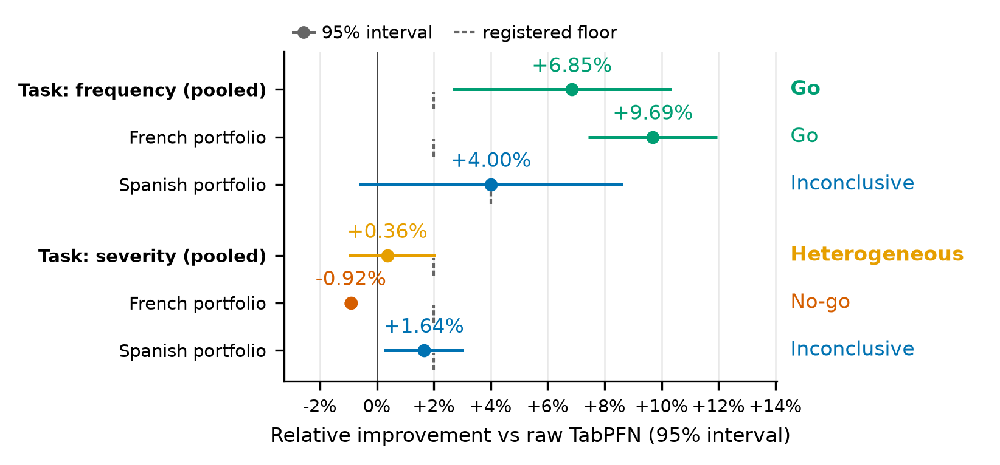

# Frequency/severity fair test — result

> **Status:** current — verdict recorded 2026-11-12; both halves of the row-scaling arm (#572) added
> 2026-11-13 and do not change the verdict. Supersedes the gate's preview
> (`freq_sev_power.md`), which said in advance that it was not a verdict.
> **Question:** does fine-tuning TabPFN beat using it untouched, on claim frequency and per-claim
> severity, across a French and a Spanish portfolio?
> **Answer:** yes for claim frequency (pooled **+6.85%**, CI [+2.65%, +10.36%], **Go** against the
> 2% floor); no for severity (pooled **+0.36%**, CI [−0.99%, +2.06%], **heterogeneous** — the two
> portfolios disagree in sign, so no task-level gain is claimed).
> **At scale:** both targets were then re-tested at the largest training budget their data allows
> (#572). Severity stayed **No-go** at 2.1× the cap; frequency stayed **Go** at 4×, on a larger point
> estimate. Neither moves the verdict above.

## Design, as registered

`REGRESSOR_FINETUNING_PREREGISTRATION_FREQ_SEV_2026-11.md`. Four targets; arms
`A_raw` versus `B_ft30`; five policy-grouped folds (`random_state=42`); three model seeds per fold;
training capped at 10,000 rows; every arm and seed in a target sees the same test rows. The
statistic is the per-fold, per-seed relative improvement

```
r_{t,f,s} = (M(A_raw) - M(B_ft30)) / M(A_raw)
```

averaged over seeds inside each fold. Target intervals are paired t over five folds (4 df); task
intervals are the registered two-way bootstrap (portfolios × folds, 10,000 draws, indicative
because two portfolios is a thin resample).

Recomputed from the retained captures by `scripts/analyses/freq_sev_fair_test.py`, which reads
each slot's recorded `verdict_metric_value` and applies the decision rule below. The run ids:

| Target | Run id | Capture |
|---|---|---|
| frequency_french | `20261112T164543Z` | v3, `freMTPL2freq`, 30 entries |
| frequency_spanish | `20261112T184155Z` | v3, `spanish_motor_freq`, 30 entries |
| severity_french | `20261112T210029Z` | v4, `freMTPL2sev`, 30 entries |
| severity_spanish | `20261112T220641Z` | v4, `spanish_motor_severity`, 30 entries |

Every capture passes `check_citations.check_run_dir`: 2 arms × 5 folds × 3 seeds, all hashes
present. Severity captures carry `weights_sha256` and `cluster_sha256`; frequency captures carry
`exposure_sha256` and neither of the severity pair, as the contract requires.

The row-scaling arms (#572) are two further captures, neither one of the four the verdict is
registered on — `20261113T003320Z` (v4, `freMTPL2sev`) and `20261113T095502Z` (v3, `freMTPL2freq`),
30 entries each, same contract. Both are reported separately below.

## Result

| Target | r | 95% CI | MDE | Floor | Decision |
|---|---:|---|---:|---:|---|
| frequency_french | **+9.69%** | [+7.43%, +11.95%] | 2.28% | 2% | **Go** |
| frequency_spanish | **+4.00%** | [−0.64%, +8.65%] | 4.69% | 4% | **Inconclusive** |
| severity_french | **−0.92%** | [−1.16%, −0.68%] | 0.24% | 2% | **No-go** |
| severity_spanish | **+1.64%** | [+0.24%, +3.05%] | 1.42% | 2% | **Inconclusive** |
| **Task: frequency** | **+6.85%** | [+2.65%, +10.36%] | — | 2% | **Go** |
| **Task: severity** | **+0.36%** | [−0.99%, +2.06%] | — | 2% | **Heterogeneous** |

Decision rule, from the pre-registration: **Go** when the CI excludes zero and the point estimate is
at or above the floor; **No-go** when the CI upper bound is below the floor; **Inconclusive** when
the CI covers both zero and the floor, or the target is underpowered. Task floors are 2%; Spanish
frequency carries its own 4% per-target floor and does not decide the frequency task.



*Figure 1 — the verdict as a picture.* One row per pooled task, with its two portfolios beneath it; the line is the
95% interval, the dashed tick below it the row's registered floor, and the word at the right the
decision the rule returned. French frequency clears its 2% floor; French severity is a small but real
harm; both Spanish cells are inconclusive against their floors; and the pooled severity task is
heterogeneous because the two portfolios disagree in sign. Every value is computed from the four
committed captures by `freq_sev_fair_test.build_summary()` — the function that prints the table above —
so the figure cannot disagree with it. The 2.1× and 4× row-scaling arms ([below](#the-row-scaling-arm-572))
are robustness checks on this verdict, not a second verdict, and are not drawn. Regenerate with
`.venv/bin/python scripts/infra/verdict_figures.py --only fair-test`; vector PDF at
[`figures/freq_sev_forest.pdf`](../../figures/freq_sev_forest.pdf).

## What the numbers say, and what they do not

**Frequency: fine-tuning helps, and the French target decides it.** French frequency's interval sits
entirely above its floor, four times its own MDE. Spanish frequency is directionally positive
(+4.00%) but its interval includes zero, so on its own it is inconclusive — the pooled task interval
is what carries the decision, exactly as registered.

**Severity: fine-tuning does not help, and on the French claims it slightly hurts.** The French
effect is small but real — the CI excludes zero and lies entirely below it, so "no effect" is
*excluded*: fine-tuning made per-claim severity worse by about 0.9%. Spanish severity is positive
(CI [+0.24%, +3.05%], excludes zero) but below the 2% floor and covers it, so it is inconclusive
rather than a win. Because the two portfolios disagree in sign, the task is **heterogeneous** and no
task-level severity gain is claimed, per the pre-registration.

**The gate's preview held.** Measured against the gate's point estimates (+9.42% / +4.49% / −0.92% /
+1.63%), the fair test returned +9.69% / +4.00% / −0.92% / +1.64% — same seeds, same folds, so this
is the reproduction it should be. The **intervals widened** relative to the gate's MDEs (1.65% →
2.28%, 3.85% → 4.69%, 0.50% → 0.24%, 1.35% → 1.42%): the gate's five folds underestimated
fold-level variance for the two frequency targets. That is why Spanish frequency's MDE (4.69%) now
exceeds its own 4% floor.

## The row-scaling arm (#572)

The verdict above is measured on a 10,000-row training cap — 48% of the French severity claims
available to a fold, and 1.8% of the French frequency policies. #572 registered a repeat at a
40,000-row budget applied to **both** arms, on severity first and frequency second. Both halves have
now run. Neither changes the registered verdict, and together they close the question the amendment
was written to ask: severity could not reach 4× (its folds hold only 2.1× the cap), frequency could
and did.

| Target | Budget | r | 95% CI | MDE | Decision |
|---|---:|---:|---|---:|---:|
| frequency_french | 10,000 (registered) | +9.69% | [+7.43%, +11.95%] | 2.28% | Go |
| frequency_french | **40,000** (4×, `20261113T095502Z`) | **+11.84%** | [+8.93%, +14.76%] | 2.94% | **Go** |
| severity_french | 10,000 (registered) | −0.92% | [−1.16%, −0.68%] | 0.24% | No-go |
| severity_french | **21,177** (2.1×, the whole claim pool, `20261113T003320Z`) | **−0.79%** | [−1.55%, −0.03%] | 0.77% | **No-go** |
| frequency_spanish | 10,000 (registered) | +4.00% | [−0.64%, +8.65%] | 4.69% | Inconclusive |
| severity_spanish | 10,000 (registered) | +1.64% | [+0.24%, +3.05%] | 1.42% | Inconclusive |

The two Spanish targets were **not** re-run: at ~42,800 policies and ~8,900 claim-equivalents they
were never capped in the way the French targets were, and each needs a new registration rather than
a larger budget. Their rows are the registered ones, and their intervals are unaffected.

### Severity: 2.1×, the most this dataset can express

On French severity the budget clamped to the fold's whole claim pool, so the arm trained on
**21,131–21,177 rows**: 2.1× the cap and every claim the fold had. Thirty entries, same folds, same
seeds, same decision rule.

**The No-go survives at 2.1× the rows.** The point estimate moves 0.13 points toward zero and the
interval is about three times wider (−0.68% to −0.03% at the upper bound). It still excludes zero,
but by only three basis points: the harm is small at this budget, and this run does not pin its
size. Against the floor the answer is unambiguous — an upper bound of −0.03% is two points below
the registered 2% — so the cap was not what made French severity a No-go.

**The registered 4× was not reachable.** The amendment raised the budget to 40,000 rows; a fold's
whole claim pool is 21,131–21,177, so the arm ran at the largest budget this dataset can express.
#572's hypothesis — that the severity null is row starvation — is therefore answered at 2.1×, not
at the 4× it named, and the gap is the data's rather than the design's.

**The reading is the target's, not the task's.** The No-go above applies the registered rule to
`severity_french`'s own interval. The task verdict is not recomputed at the raised budget, because
Spanish severity was not re-run: severity still reads **Heterogeneous** from the four registered
captures, and no task-level number moves.

The per-fold pattern says the same without the average: four of five folds are negative (−0.29%,
−1.19%, −1.17%, −1.33%) and the fifth is +0.02%.

### Frequency: the 4× the budget was written for

French frequency is the starved target — 10,000 of the ~542,000 policies a fold can train on, 1.8%
— and the only one where the registered 40,000 is reachable. The arm ran at **40,000 rows on every
fold**, both arms, thirty entries, and on **exactly the test rows the registered run used**: every
fold's `test_index` and `ground_truth` hashes are identical to `20261112T164543Z`, so the only thing
that moved between its two rows in the table above is the training budget.

**The Go does not weaken.** The point estimate rises 2.15 points and the interval's lower bound
rises with it, from +7.43% to +8.93% — still nearly seven points clear of the 2% floor. All five
folds clear the floor on their own (+8.03%, +13.52%, +12.53%, +13.84%, +11.30%), so the result is
not one fold carrying a mean. Every slot in both rows was measured under the same pin: `v3_default`
(`tabpfn-v3-regressor-v3_default.ckpt`, tabpfn 8.5.0, Python 3.11.12), as each capture's `meta.json`
records.

**What this does and does not establish.** The concern the amendment was written to test was that
the 10,000-row cap *created* the frequency win — the classifier lane's history read the other way
round, with fine-tuning looking useless at 2,000 rows and working at 10,000. At 4× the budget the
gain is not smaller, so +9.69% was not an artefact of a starved context. It does **not** establish
that the gain
grows with rows: the two intervals overlap substantially, and no statistic for the difference
between budgets is registered. Three of five folds improved and two fell slightly (−1.81% and
−1.35%), which is the shape a noise-dominated 2-point difference should have.

Precision moves the other way: MDE widens from 2.28% to 2.94%, so the 40,000-row arm is *less*
precise per fold despite the larger effect. Both intervals sit clear of the floor, as their lower
bounds (+7.43% and +8.93%) show.

**Schema difference between the two halves is expected.** The severity capture is schema v4 and the
frequency capture v3. v4 adds the per-row `weights.npy` and `cluster_id.npy` arrays, which the
**grouped severity** verdict metric needs and the frequency verdict metric (Poisson deviance) does
not; the v3/v4 split is the writer's rule, not a difference in what was captured.

## Limits

- **Not a comparison with actuarial baselines.** Both arms are TabPFN; `E_glm` and `F_catboost` are
  not in this run. This measures the value of fine-tuning, not the value of TabPFN.
- **The epoch ladder was not run.** `B_ft10` and `B_ft3` are a follow-up; no floor is registered for
  them, so they could not have moved these decisions.
- **The row cap is settled at the budgets this data allows.** French severity was repeated on each
  fold's whole claim pool (21,131–21,177 rows, 2.1× the cap) and stayed No-go; French frequency was
  repeated at the full 40,000 rows (4× the cap) and stayed Go, with a larger point estimate. Neither
  target can be pushed further without a bigger dataset, and neither needed to be.
- **Spanish frequency is underpowered at its floor.** Its MDE (4.69%) is above the 4% bar, so a true
  effect of 4% would be missed roughly half the time. More folds would fix it; the pre-registration
  fixes five, so that is a new registration.
- **Severity's Spanish interval is clustered by policy** as registered; the French severity point
  estimate is one small negative number and should not be read as a magnitude worth acting on.
- **Quantiles were captured but are not analysed here.** The verdict uses the recorded deviance /
  weighted RMSE per slot; calibration and interval work is a separate question.

## Reproduce

```
python scripts/analyses/freq_sev_fair_test.py \
  --frequency-french 20261112T164543Z --frequency-spanish 20261112T184155Z \
  --severity-french 20261112T210029Z --severity-spanish 20261112T220641Z \
  --row-scale-french 20261113T003320Z --row-scale-frequency 20261113T095502Z
```

It prints the tables above — including each row-scaling arm's per-fold ratios — and `--json` emits
the same as data. `--row-scale-french` and `--row-scale-frequency` keep each arm out of its task
mean, so the four registered rows are byte-for-byte what was published on 2026-11-12.
`./scripts/check.sh citation` proves each cited id has the capture it claims.
